<picture>
  <source media="(prefers-color-scheme: dark)" srcset="assets/header-dark.svg">
  
</picture>

Architecting <strong>high-concurrency commerce engines</strong>, multi-branch ERP sync &amp; payment systems.

Currently <strong>Back-End PHP Developer</strong> at <strong>MitchDesigns</strong> — Egypt &amp; GCC.

<picture>
  <source media="(prefers-color-scheme: dark)" srcset="assets/focus-dark.svg">
  
</picture>

<picture>
  <source media="(prefers-color-scheme: dark)" srcset="assets/tool-php-dark.svg">
  
</picture>
<picture>
  <source media="(prefers-color-scheme: dark)" srcset="assets/tool-laravel-dark.svg">
  
</picture>
<picture>
  <source media="(prefers-color-scheme: dark)" srcset="assets/tool-mysql-dark.svg">
  
</picture>
<picture>
  <source media="(prefers-color-scheme: dark)" srcset="assets/tool-postgres-dark.svg">
  
</picture>
<picture>
  <source media="(prefers-color-scheme: dark)" srcset="assets/tool-redis-dark.svg">
  
</picture>
<picture>
  <source media="(prefers-color-scheme: dark)" srcset="assets/tool-docker-dark.svg">
  
</picture>
<picture>
  <source media="(prefers-color-scheme: dark)" srcset="assets/tool-linux-dark.svg">
  
</picture>
<picture>
  <source media="(prefers-color-scheme: dark)" srcset="assets/tool-git-dark.svg">
  
</picture>

<picture>
  <source media="(prefers-color-scheme: dark)" srcset="assets/stats-dark.svg">
  
</picture>

<picture>
  <source media="(prefers-color-scheme: dark)" srcset="assets/snake-dark.svg">
  
</picture>

---

Shipping production backend systems for retail &amp; enterprise commerce. Giza, Egypt.

  <a href="https://yossef-ashraf.pages.dev/">Portfolio</a> ·
  <a href="https://linkedin.com/in/yossef-ashraf">LinkedIn</a> ·
  <a href="https://lh3.googleusercontent.com/d/13neCMNFd_e7ClTtT3RS6zIpkEFtljqOZ">Resume / CV</a> ·
  <a href="mailto:yossef.ashraf.dev@gmail.com">Email</a>

Architect, benchmark, ship.

